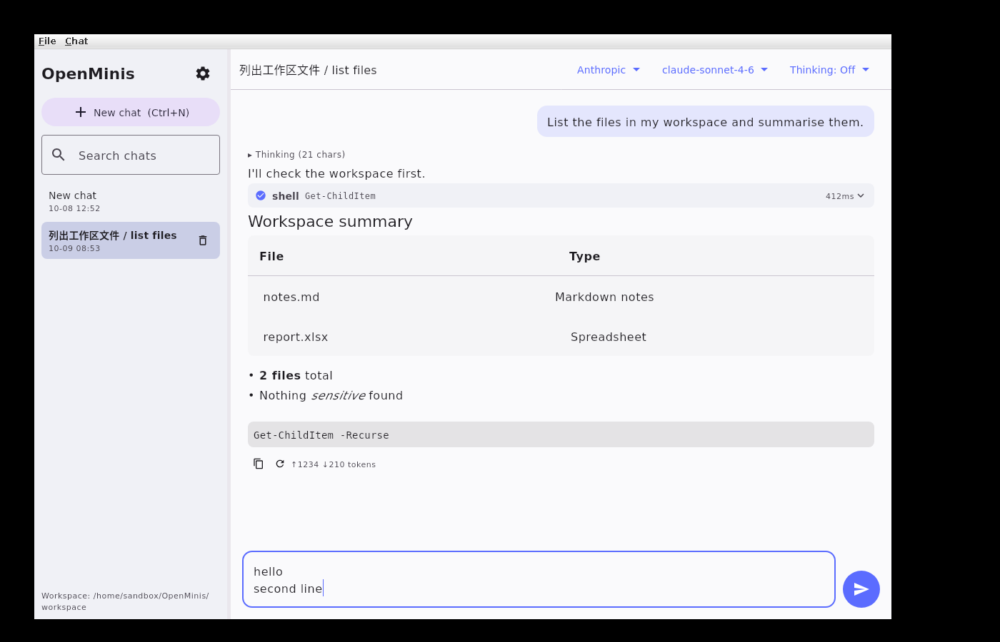

# OpenMinis Desktop（Windows 版）

OpenMinis 是一个开源 AI Agent 应用（[GitHub](https://github.com/OpenMinis/OpenMinis)，GPLv3）。
本目录是它的 **Windows 桌面移植版 MVP**，使用 **Compose Multiplatform for Desktop（JVM）** 构建，
直接复用了 Android 版的 LLM 提供商流式代码（Anthropic / OpenAI 兼容 / Gemini）、数据模型和工具循环检测器。



## 功能

- 多提供商流式对话：Anthropic、OpenAI、Google Gemini、OpenRouter、xAI、DeepSeek，以及任意 OpenAI 兼容端点（Ollama / LM Studio / vLLM / 中转站）
- API Key、Base URL、模型 ID 设置（`Ctrl+,` 打开设置）
- 会话列表 + 本地持久化（`%APPDATA%\OpenMinis\conversations\*.json`），支持搜索、删除、重新生成
- Agent 工具调用：`shell`（PowerShell / cmd / WSL）、`file_read`、`file_write`、`file_edit`、`list_dir`、`memory_write`、`memory_get`
- **运行前确认**：默认每条 shell 命令弹窗确认；危险命令（`rm -rf /`、`format C:`、`Remove-Item -Recurse C:\` 等，含 `sh -c` / `powershell -EncodedCommand` 嵌套）直接拒绝；含 `> | ; & $(` 等元字符或调用解释器的命令始终确认；只读命令（ls / dir / Get-ChildItem …）可免确认；文件工具只能访问工作区（越界硬拒绝）
- Skills：读取 `SKILL.md` 文件夹（`%APPDATA%\OpenMinis\skills\<名称>\SKILL.md` 或 `<工作区>\.skills\`）
- 记忆：`GLOBAL.md`（用户维护）+ 每日日志 `YYYY-MM-DD.md`（Agent 写入），与 Android 版布局一致；`memory_get` 为中英文分词（jieba）+ BM25 排序 + 近期加权的检索
- **上下文压缩**（批次 1）：接近模型上下文窗口时自动压缩，或点工具栏压缩按钮 / `Ctrl+Shift+K` / 输入 `/compact`；可查看摘要、撤销
- **附件**（批次 1）：拖拽文件到窗口、`Ctrl+V` 粘贴截图或资源管理器中复制的文件、回形针按钮；图片按上游 ImageBudget 缩放后发送，文本文件内联，其它文件把路径交给 Agent
- **模型回退链**（批次 1）：设置 → Fallback models；遇到 429 / 5xx / 过载 / 网络错误时自动切换到下一个模型
- Markdown 渲染（标题、表格、代码块、列表）、思考过程折叠、工具调用卡片（可展开参数和结果）
- 桌面布局：左侧可拖拽调整宽度的会话栏 + 右侧聊天区
- 快捷键：`Enter` 发送，`Shift+Enter` 换行，`Ctrl+N` 新建会话，`Ctrl+,` 设置，`Esc` 停止生成，`Ctrl+V` 粘贴附件，`Ctrl+Shift+K` 压缩上下文

## 数据位置

| 内容 | 路径 |
|---|---|
| 设置（含 API Key，明文） | `%APPDATA%\OpenMinis\settings.json` |
| 会话 | `%APPDATA%\OpenMinis\conversations\` |
| 记忆 | `%APPDATA%\OpenMinis\memory\` |
| Skills | `%APPDATA%\OpenMinis\skills\` |
| 日志 | `%APPDATA%\OpenMinis\logs\` |
| 附件 | `%APPDATA%\OpenMinis\attachments\<会话ID>\` |
| Agent 默认工作区 | `%USERPROFILE%\OpenMinis\workspace` |

可用环境变量 `OPENMINIS_HOME` 或 JVM 参数 `-Dopenminis.home=...` 更改数据目录。

## 直接运行（uber-jar）

需要先安装 **Java 17 或更高版本**（例如 [Adoptium Temurin 17](https://adoptium.net/)）：

```powershell
java -Dfile.encoding=UTF-8 -jar OpenMinis-windows-x64-1.14.0.jar
```

该 jar 已内置 Windows x64 的 Skia 原生库，可在 Linux 上交叉构建。

**编码（hotfix 1）**：程序内部所有字节→文本转换都显式使用 UTF-8（模型流式输出、JSON、日志、MCP），
外部命令输出按 UTF-8 / 系统代码页（如 GBK）/ UTF-16LE 自动识别，因此**不加 `-Dfile.encoding=UTF-8` 也能正确显示中文**；
加上只是让第三方库也默认 UTF-8。MSI/EXE 安装包已内置该参数。不要覆盖 `sun.jnu.encoding`（它必须与系统代码页一致）。

**代理**：设置 → Network。默认 “System”：优先读取 `HTTPS_PROXY` / `HTTP_PROXY` / `ALL_PROXY` / `NO_PROXY`，
否则使用 Windows 系统代理（设置 → 网络和 Internet → 代理）。也可选 “No proxy” 或手动 HTTP/SOCKS5（可选用户名密码、绕过列表）。
TCP 连接 + TLS 握手超过设定秒数（默认 20 s）会被中止并报错（随后重试 / 切换备用模型），不会一直停在 “Thinking…”。

**无障碍**：审批对话框 Enter = 允许，Esc = 拒绝，Ctrl+Enter 或 A = 总是允许；所有对话框 Esc 关闭；Tab / Shift+Tab 在控件间移动。
屏幕阅读器（Windows UI Automation）需要启用 Java Access Bridge：`%JAVA_HOME%\bin\jabswitch -enable`。

## 从源码构建（Windows）

前置条件：JDK 17+（Temurin 自带 `jpackage`），无需单独安装 Gradle（使用 wrapper）。
MSI/EXE 打包需要 WiX Toolset 3，Compose 插件会在首次打包时自动下载。

```powershell
cd src\desktop

# 编译 + 单元测试
.\gradlew.bat :desktop:compileKotlin
.\gradlew.bat :desktop:test

# 开发运行
.\gradlew.bat :desktop:run

# 可运行的 uber-jar（需要 Java）
.\gradlew.bat :desktop:packageUberJarForCurrentOS   # 输出 app\build\compose\jars\
.\gradlew.bat :desktop:windowsUberJar               # 输出 app\build\libs\OpenMinis-windows-x64-1.14.0.jar

# 安装包（自带 JRE，用户无需安装 Java）
.\gradlew.bat :desktop:packageMsi    # app\build\compose\binaries\main\msi\OpenMinis-1.14.0.msi
.\gradlew.bat :desktop:packageExe    # app\build\compose\binaries\main\exe\OpenMinis-1.14.0.exe
```

> `jpackage` 不能跨平台打包，MSI/EXE 必须在 Windows 上构建。
> 仓库中的 GitHub Actions 工作流 `.github/workflows/desktop-windows.yml` 会在 `windows-latest` 上自动构建并上传 MSI、EXE 和 jar。

在 Linux/macOS 上也可以编译和跑测试（`./gradlew :desktop:test`），`windowsUberJar` 同样可在 Linux 上生成 Windows 版 jar。

## 使用提示

1. 首次启动点击「Add an API key」或 `Ctrl+,`，选择提供商并填写 API Key。
2. 顶部栏可随时切换提供商、模型和思考强度（Thinking）。
3. Shell 工具默认使用 PowerShell；如已安装 WSL，可在设置中切换为 WSL（bash）。
4. **注意**：桌面版没有沙箱，命令直接在本机执行（这是有意的设计）。安全网是默认开启的「运行前确认」，请保持开启，除非你信任当前任务。

## 许可

GNU General Public License v3（见 `LICENSE`）。基于 OpenMinis Android 源码移植，保留原作者署名；移植与取舍说明见 [PORTING.md](PORTING.md)。
